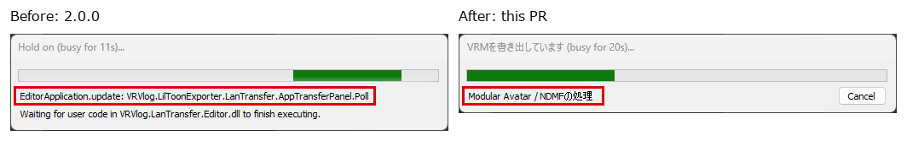

# Export progress bar: native Editor evidence

Captured from Unity 2022.3.22f1 on a Windows PC, in an isolated project with lilToon 2.3.4, Modular Avatar 1.18.7 and NDMF 1.14.8. The avatar is the synthetic fixture of `AttachmentConnectionTests` with a lilToon material; it contains no user avatar or outfit.

Both sides start the quick transfer's export the way its QR code button does, with the Modular Avatar / NDMF build stage held for 25 s through `ExportTestHooks.FaultInjection` to stand in for a large avatar. The pictures are native window captures taken while the export held the editor, placed side by side without changing their pixels. Red outlines mark the text that names what the editor waits for.

Left: 2.0.0. Unity's busy dialog names only the callback the export runs in (`AppTransferPanel.Poll`). Right: this PR. The export's progress bar names the stage and has a cancel button.

The export took 26.2 s with the bar, the same as without it (26 s). An earlier version that waited 0.12 s between stages so Unity would not drop a quick update took 34.1 s: about 70 stage changes at 0.12 s each. Clearing the bar before a quick update draws it at once without that wait.
