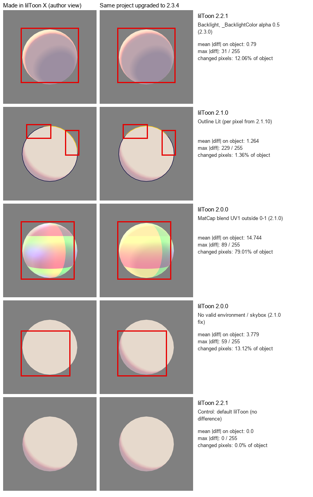

# lilToon 2.0.0-2.3.4: author view vs. 2.3.4 view

The exporter does not convert values per lilToon version, and the app renders
materials with lilToon 2.3.4 rules. A material made in lilToon 2.0.0-2.2.1
therefore appears in the app as it would after updating its project to 2.3.4.
This record compares, on the same materials, what the author saw in their
lilToon version (left) with the same project after upgrading lilToon to 2.3.4
(right). Red boxes mark the regions whose pixels differ by more than 8/255.
Nothing is corrected; the differences below are lilToon's own changes.

## Method

- Unity 2022.3.22f1, Built-in RP, Linear color space, batch mode. One empty
  project per lilToon version (official VPM release 2.0.0, 2.1.0, 2.2.1 and
  2.3.4) with lilToon referenced as a `file:` package.
- `Capture.cs.txt` (rename to `.cs` under `Assets/Editor`) creates the
  synthetic materials in the project's own lilToon version, saves them, and
  renders each one on a sphere with `Camera.Render` into a 768x768 8x MSAA
  texture: fixed camera, one white directional light (intensity 1, soft
  shadows) from the front (`front`) or from behind (`back`), solid grey
  background. The scene is saved with the default skybox and its environment
  lighting is baked, as in a scene an author opens in the Editor.
- Then the project's manifest is switched to lilToon 2.3.4 and the same saved
  `.mat` assets are rendered again (`upgraded`). lilToon's material migration
  did not run (no migration log in batch mode); for 2.x materials it only
  rewrites `_lilToonVersion`.
- `compare.py` computes per-pixel differences for every capture and draws the
  regions that changed. `composite.py` builds `comparison.png` and
  `metrics.json` from that output, keeping the synthetic materials only.
  `metrics.json` lists every synthetic material and condition: mean absolute
  difference over the object, maximum, the share of object pixels that changed
  by more than 8/255, the difference between the upgraded image and a project
  that started on 2.3.4, and for 2.0.0 the difference between two renders.
  Both scripts need Python 3 with Pillow, NumPy and SciPy.

Checks on the method itself:

- Upgraded projects match a project that started on 2.3.4 (synthetic
  materials: max difference 1/255).
- Rendering lilToon 2.0.0 twice gives the same image (max 1/255).
- A Standard-shader sphere renders identically in every project, so the
  scene, light and camera are the same.

## Results

Changed pixels as a share of the object, with the maximum difference
(8-bit). "None" means no pixel changed by more than 8/255.

| Material (condition) | 2.0.0 | 2.1.0 | 2.2.1 | Cause |
| --- | --- | --- | --- | --- |
| Backlight, `_BacklightColor` alpha 0.5 (back light) | 12.06%, 31 | 12.06%, 31 | 12.06%, 31 | 2.3.0 multiplies backlight by the color alpha; the upgraded rim is darker (mean RGB of the changed pixels 216.9 -> 210.6) |
| Backlight, `_BacklightColorTex` alpha 0.5 (back light) | 12.06%, 30 | 12.06%, 30 | 12.06%, 30 | Same, through the texture alpha |
| Backlight, alpha 1.0 (back light) | None | None | None | Alpha 1 is unaffected |
| Outline Lit, `_OutlineLitColor` alpha 1 (front light) | 1.36%, 229 | 1.36%, 229 | None | Per-vertex before 2.1.10, per-pixel from 2.1.10 |
| MatCap with `_MatCapBlendUV1` (1,1), UV1 outside 0-1 (front / back) | 54.74%, 82 / 79.01%, 89 | None | None | 2.1.0 clamps UV1 to 0-1 |
| Shadow with 3rd color and `_ShadowEnvStrength` 1 | None | None | None | See limits |
| lilToonLite shadow with `_ShadowEnvStrength` 1 | None | None | None | See limits |
| 2nd texture as an animated decal | None | None | None | Not affected in this setup |
| Default lilToon (control) | None | None | None | - |

One representative avatar (all lilToon materials, outline on, backlight,
MatCap and Outline Lit off) was also rendered: full body front, three-quarter
and face close-up, front and back light. Changed pixels stayed at 0.06% or less
of the object in every version, the same level as rendering one project twice
(isolated pixels at skinned-mesh edges). The avatar and its images are not
published here.

### lilToon 2.0.0 without a valid environment

When the renderers receive zero ambient spherical harmonics (the light probe
data of a scene without valid environment lighting; simulated here by handing
each renderer a zero probe, and first seen in an empty unsaved scene), lilToon
2.0.0 draws the whole surface at the lit
color: no light/shadow gradation (fourth row of the image; 13% of the sphere,
up to 38% of the avatar body and 58% of its face). 2.1.0 and later shade
normally in the same scene. lilToon 2.1.0's change log lists "Shadows are not
cast if the Skybox is invalid". This only changes what the author saw in such a
scene; with valid environment lighting 2.0.0 matches the table above.

## Limits

- Built-in RP in the Unity Editor only. The app (Unity 6, URP, Android/iOS) was
  not compared here. The app renders every version's export with the same
  2.3.4 rules, so it shows the right-hand column for each version; whether the
  exports themselves are identical is checked separately by the version parity
  harness (#149).
- 2.1.0 moved the environment-light blend of lilToonLite's shadow color before
  the clamp to the lit color, and added a `saturate` to the same blend in
  lilToon (which has no effect because the input is already 0-1). The two
  orders give the same result when the light color is 1, which is the case
  here (lilToon limits the light color to 1, and a white light of intensity 1
  reaches that limit). A dimmer or colored main light can change lilToonLite
  shadows; that was not rendered.
- 2.1.10, 2.2.0, 2.3.0 and 2.3.3 were not rendered. Outline Lit uses per-pixel
  code from 2.1.10 (`outlineNdotL` in `lil_common_frag.hlsl`).
- Shader Setting changes, encrypted materials and custom shaders were not
  tested.

Refs #150, #145
