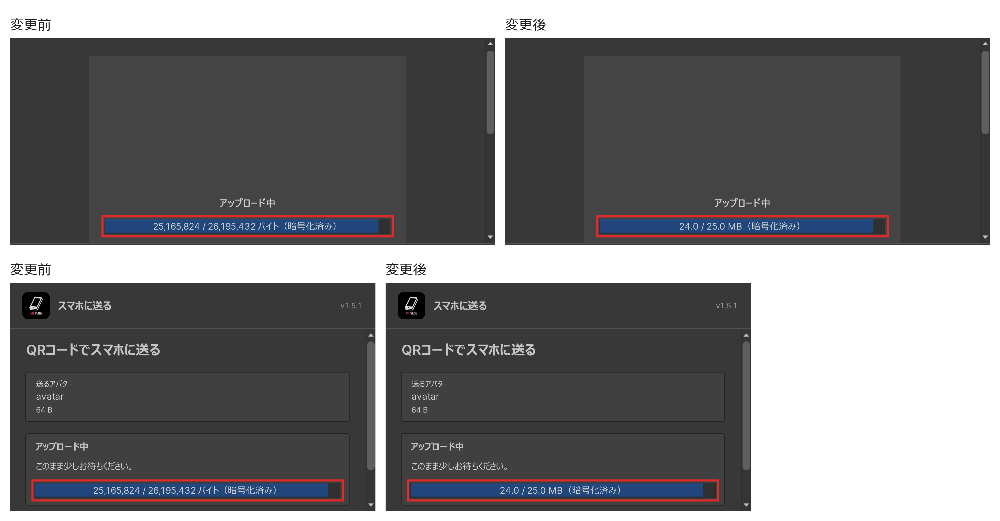

# Upload progress in KB, MB and GB: Editor UI evidence

Captured from Unity 2022.3.22f1 on Windows with the Editor UI scale at 300%, so the picture is three times the window size. Left: develop `7080f4b7`. Right: this change. Both sides use the same isolated project and put the transfer in the uploading state with 25,165,824 of 26,195,432 bytes sent, without network access. Red outlines mark the progress bar.

Top: the quick transfer window below its header (the header names the scene's avatar, so it is cut off). Bottom: the "send to phone" window.

The same check covered English, Korean, Simplified Chinese and Traditional Chinese, the start (0 bytes), the end, a 2 KB total and a 256 MB total. The bar keeps its width; only the centred text changes.
