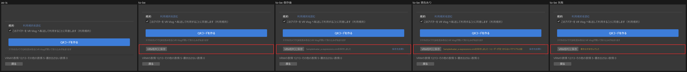
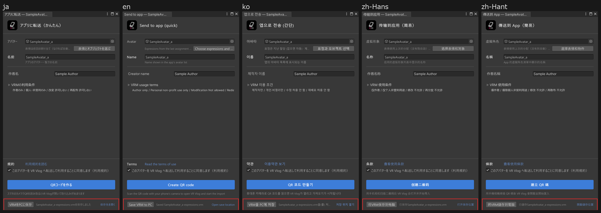

# 転送の画面に「VRMをPCに保存」を置く

- 日付: 2026-10-22
- 対象: `Editor/LanTransfer/AppTransferPanel.cs`・`Editor/LanTransfer/AppTransferWindow.uxml`・`Editor/LanTransfer/AppTransferWindow.uss`・`Editor/AppTransferExport.cs`・`Editor/ExperimentalExpressionCaptureWindow.cs`・`Editor/Locales/*.json`・`Tests/LanTransfer/CloudTransferWindowTests.cs`

## 背景

**アプリに転送（かんたん）** のウィンドウと **アプリに転送（通常）** の3ページ目には、QRを作るボタンしかなかった。送る前に同じVRMを手元にも残したいときは、別の画面（「VRMを書き出す」か表情ボードの **VRMを保存**）を開き直す必要があった。mk が 10/22 に「アプリに転送の画面からでも、PCに保存できるボタンを用意しておいてほしい」と依頼した。

## 決定

- 転送の画面の一番下に、ヘアラインで区切った高さ40pxの行を1つ足し、通常の見た目のボタン **VRMをPCに保存** を置く。行はフォームの画面とQRの画面（アップロード中・QRの表示中・期限切れなど）の両方で同じ位置にあり、状態が変わってもボタンは動かない。
- 強調色（青）のボタンは **QRコードを作る** だけのままにする。保存のボタンは高さ22pxの通常のボタンで、主な操作（転送）より目立たない。
- 保存は新しい書き出しを作らず、表情ボードの **VRMを保存** の保存処理（`ExperimentalExpressionCaptureWindow.Save`）をそのまま呼ぶ。
  - 保存先の画面は同じ `EditorUtility.SaveFilePanel`（「VRMの保存先」・`<アバター名>-expressions.vrm`）。ファイル名の決め方は `SaveFileName` に出して両方から使う。
  - 書き出し結果の一覧（フォールバックがあるときの確認）と、失敗したときの対策画面も **VRMを保存** と同じものが出る。失敗した段階では止まる（転送の書き出しのように段階を省いて続けない）。
  - 中身は転送で送るものと同じにする。通常は開いている表情ボードから、かんたんは転送と同じく見えないところで準備した表情ボード（`PrepareHidden`）から書き出す。名前・作者名・**VRMの利用条件** は転送の画面の値を使い、転送と同じくアバターの設定に記録する。
  - 転送と中身が違ってよい場合が2つある。1つは失敗した段階があるときで、転送はその段階を省いて送るが、保存は止まる。もう1つはポーズの上限をまだ選んでいないときで、**VRMを保存** と同じく確認を出し、答えを記録する（かんたんの転送は確認を出さずに記録済みの値か既定値を使う）。どちらも **VRMを保存** と同じ動きにした。
- 結果は行の中に1行で出す。保存したら「`<ファイル名>`を保存しました」と **保存先を開く**、シェーダーが見つからないマテリアルがあれば「…を保存しました・シェーダーが見つからないマテリアルN個」を黄色で出す。何をすればよいかの長い説明はツールチップに出す（QRの画面の警告と同じ文）。失敗したら理由の1行目を黄色で出し、全文はツールチップに出す。かんたんの表情ボードは見えないまま閉じるので、表情ボードの状態の行には出さず、転送の画面に出す。対策画面からあとで保存できたときも、この行が「保存しました」に変わる。
- 押せる条件は書き出しに要るものだけにする（アバター・作者名・表情ボードの準備ができていて直すところがない・再生中でない）。利用規約とプライバシーポリシーの同意は、外のサービスへ送るためのものなので保存には求めない。転送のための書き出しの間は押せない（Editorが書き出しで止まっているため）。アップロード中とQRの表示中は押せ、転送はそのまま続く。
- アバターを替えると前の結果は消す。
- 文言は「VRMをPCに保存」「{0}を保存しました」「{0}を保存しました・シェーダーが見つからないマテリアル{1}個」の3つを足し、en・ko・zh-Hans・zh-Hantの訳を入れた。「保存先を開く」「VRMの保存先」「書き出せませんでした」は既存の訳を使う。依頼では7言語とあったが、このパッケージの言語は日本語を含めて5つなので5つで対応した。
- **アプリに転送（かんたん）** のウィンドウは行の分（41px）だけQRの計算に使う高さ（`TransferChrome`）を増やした。表情ボードの3ページ目は今までどおり残りの高さに合わせてQRを縮める。

## 検討して採らなかったもの

- QRの画面のフッター（**QRを作り直す** の並び）とフォームのフッター（**QRコードを作る** の下）に別々に置く案。状態でボタンの位置が変わるので採らなかった。
- 保存のときも転送と同じく失敗した段階を省いて書き出す案。**VRMを保存** と同じ処理を呼ぶという依頼に合わせて、表情ボードの保存と同じく止める方にした。
- 表情ボードの状態の行に結果を出す案。かんたんでは表情ボードが見えないので出せない。

## 確かめたこと

Unity 2022.3 のEditorで、表情ボードの3ページ目（幅600・800・1000）と **アプリに転送（かんたん）**（幅420・520・700）を5言語で3倍に撮り、as-isと比べた。状態はフォーム・アップロード中・QRの表示中・保存後・警告あり・失敗。

- 保存の行の高さは全件40px。ウィンドウの大きさが同じなら、状態と言語を替えても行のyは変わらない。結果の文は全件1行で、はみ出す分は省略される。
- 青いボタンは今までどおり **QRコードを作る** の1つだけ。
- QRの一辺はボード600で334から308、800と1000で359から308になった（行の分だけ縮む）。かんたんはQRの一辺が変わらず、ウィンドウが行の分だけ伸びる。
- 最初の実装では `.save` に `max-width: 50%` があり、かんたんの最小幅420で ko・zh-Hans・zh-Hant のボタン名が「VRM을 PC에 ...」のように省略された。`max-width` を外してボタンは文字の幅を保ち、省略は結果の文だけにした。撮り直して5言語ともボタン名が省略されないことを確かめた（最も広い zh-Hans・zh-Hant で110.67px）。
- かんたん（`PrepareHidden`）と通常（開いている表情ボード）の両方で `SaveTransferCopy` から実際にVRMを保存し、どちらもglTFのファイル（202,600バイト）ができ、結果のコールバックが1回呼ばれることを確かめた。
- EditModeテストは転送まわり（`CloudTransferWindowTests`・`QuickTransferMatchesDefaultNormalTests` ほか）が全件通った。全体で失敗した51件は、developでも同じように失敗する、このPCの環境に依存するもの（テスト用のモデルや依存パッケージが無い等）。

